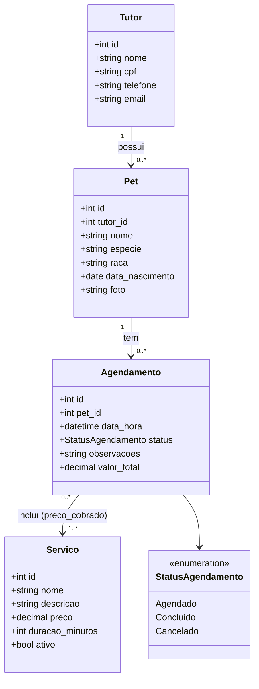

# Animalia — Sistema de agendamento para petshop

Trabalho Final da disciplina de Linguagem de Programação · Ciência da Computação · IFRS Campus Ibirubá · 2026/2

> **Status:** autenticação e dashboard implementados. Os módulos de tutores, pets, serviços e agendamentos ainda serão criados.

## Integrantes

_(a definir)_

## Descrição do problema

_(rascunho — revisar)_ Petshops de pequeno porte costumam controlar os horários de banho, tosa e consultas em cadernos ou mensagens avulsas. Isso gera conflitos de horário, perda de informação sobre os pets e dificuldade para saber o que foi feito e quanto foi cobrado.

## Objetivo da aplicação

Permitir que o petshop cadastre tutores, pets e serviços e agende um ou mais serviços para um pet em determinada data e hora, acompanhando o atendimento até a conclusão ou o cancelamento e o valor total de cada agendamento.

## Principais funcionalidades (planejadas)

- [x] **Login** (e-mail, senha, lembrar-me, logout)
- [x] **Cadastro** de conta (nome, e-mail, senha com confirmação)
- [x] **Dashboard** protegido com cartões de resumo
- [ ] CRUD de **tutores** (com pesquisa)
- [ ] CRUD de **pets** (com foto e pesquisa)
- [ ] CRUD de **serviços** (nome, preço, duração, ativo/inativo)
- [ ] **Agendamento** de um ou mais serviços para um pet (fluxo principal), com total calculado
- [ ] Concluir e cancelar agendamentos
- [ ] Validação dos dados e mensagens de sucesso e erro
- [ ] Listagem com pesquisa e filtros

## Tecnologias utilizadas

- PHP 8.3+ e [Laravel](https://laravel.com) 13
- SQLite (Eloquent ORM + migrations)
- Blade, Bootstrap 5 e CSS próprio
- Git e GitHub

## Estrutura do projeto

```
app/
├── Http/
│   ├── Controllers/
│   │   ├── AutenticacaoController.php   # login e logout
│   │   ├── CadastroController.php       # criação de conta
│   │   └── DashboardController.php
│   └── Requests/
│       ├── LoginRequest.php             # validação do formulário de login
│       └── CadastroRequest.php          # validação do formulário de cadastro
├── Models/
│   └── User.php
├── Repositories/           # (a usar nos próximos módulos)
└── Services/
    └── CadastroService.php              # criação do usuário no banco
database/
├── migrations/             # esquema do banco
└── seeders/
resources/views/
├── layouts/
│   ├── principal.blade.php   # com navbar (usuário autenticado)
│   └── visitante.blade.php   # sem navbar (login e cadastro)
├── partials/
│   └── alertas.blade.php     # mensagens flash de sucesso e erro
├── autenticacao/
│   ├── login.blade.php
│   └── cadastro.blade.php
├── dashboard/
│   └── index.blade.php
└── tutores/ pets/ servicos/ agendamentos/   # (a implementar)
routes/web.php              # rotas de autenticação e dashboard
public/css/
└── animalia.css            # identidade visual
tests/Feature/
└── AutenticacaoTest.php    # testes de login, cadastro, dashboard e logout
docs/                       # diagrama de classes e prints das telas
```

## Como configurar e executar

Requisitos: **PHP 8.3+** (com as extensões `pdo_sqlite`, `mbstring`, `xml`, `fileinfo`) e **Composer**.

```bash
git clone <url-do-repositorio>
cd animalia

composer install

cp .env.example .env              # Windows (cmd): copy .env.example .env
php artisan key:generate

touch database/database.sqlite    # Windows (cmd): type nul > database\database.sqlite
php artisan migrate --seed
php artisan storage:link          # necessário para as fotos dos pets

php artisan serve
```

A aplicação ficará disponível em <http://localhost:8000>.

Testes: `php artisan test`

## Banco de dados

SQLite, em `database/database.sqlite` (arquivo criado localmente, **não** versionado). A conexão é configurada em `.env` (`DB_CONNECTION=sqlite`) e `config/database.php`.

Modelo planejado:

| Tabela                | Descrição                                              |
|-----------------------|--------------------------------------------------------|
| `tutores`             | donos dos pets                                         |
| `pets`                | animais atendidos (pertencem a um tutor)               |
| `servicos`            | serviços oferecidos e seus preços                      |
| `agendamentos`        | agendamento de um pet em uma data/hora, com status     |
| `agendamento_servico` | serviços de cada agendamento (com o preço cobrado)     |

Relacionamentos: **Tutor 1—N Pet**, **Pet 1—N Agendamento** e **Agendamento N—N Servico**.

## Prints das principais telas

_(adicionar prints em `docs/imagens/` após rodar o projeto)_

| Tela | Print |
|------|-------|
| Login | _(pendente)_ |
| Cadastro | _(pendente)_ |
| Dashboard | _(pendente)_ |

## Diagrama de classes

> TODO: exportar o diagrama para `docs/diagrama-classes.png`, referenciá-lo com
> `` e mantê-lo atualizado conforme a implementação.
> O diagrama abaixo é a proposta inicial.



## Vídeo de apresentação

_(link do YouTube, não listado, a ser adicionado)_
