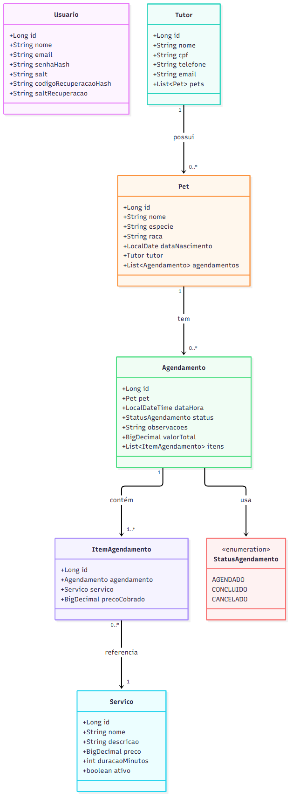

# Animalia — Sistema de Agendamento para Petshop

Trabalho Final de Linguagem de Programação III — IFRS Campus Ibirubá, 2026/2.

## Descrição do problema

Petshops gerenciam agendamentos de serviços (banho, tosa, consulta) para seus clientes (tutores) e seus animais (pets). O controle manual por telefone ou papel gera erros de horário, perda de histórico e dificuldade de consulta. Este sistema resolve esse problema com uma aplicação desktop simples.

## Objetivo

Desenvolver uma aplicação desktop para controle de agendamentos de serviços de petshop, cobrindo cadastro de tutores, pets e serviços, geração de agendamentos e visualização de estatísticas básicas.

## Integrantes

> A definir

## Funcionalidades

### Implementado neste marco
- [x] Banco de dados SQLite com todas as entidades (Usuario, Tutor, Pet, Serviço, Agendamento, ItemAgendamento)
- [x] Criação automática das tabelas ao iniciar a aplicação
- [x] Autenticação com PBKDF2 + salt (sem senha em log ou texto puro no banco)
- [x] Cadastro de usuário com validação e código de recuperação único
- [x] Login com mensagem genérica (não revela se foi e-mail ou senha errada)
- [x] Recuperação de senha por código, com limite de 5 tentativas por sessão
- [x] Tela de login, cadastro e recuperação de senha (JavaFX + FXML)
- [x] Dashboard com contagens reais do banco ligadas por bindings
- [x] Navegação entre telas e sessão de usuário
- [x] CSS com identidade visual teal/escuro/amarelo

### Próxima etapa
- [ ] CRUD de Tutores
- [ ] CRUD de Pets
- [x] CRUD de Serviços (listagem com busca, cadastro, edição, ativar/desativar e exclusão protegida)
- [ ] Fluxo de agendamento (criar, editar, cancelar, concluir)
- [ ] Dashboard completo com filtros por período

## Tecnologias

| Tecnologia            | Versão   | Finalidade                        |
|-----------------------|----------|-----------------------------------|
| Java                  | 21+      | Linguagem                         |
| JavaFX                | 21       | Interface gráfica desktop         |
| FXML                  | —        | Descrição declarativa das telas   |
| Hibernate ORM         | 6.6.4    | Mapeamento objeto-relacional      |
| SQLite                | 3.46.1   | Banco de dados em arquivo         |
| JUnit Jupiter         | 5.11.3   | Testes automatizados              |
| Maven                 | 3.10.2   | Build e dependências              |

## Estrutura do projeto

```
animalia/
├── src/
│   ├── main/
│   │   ├── java/ifrs/ibiruba/animalia/
│   │   │   ├── App.java                    Ponto de entrada JavaFX
│   │   │   ├── controller/                 Controllers das telas FXML
│   │   │   ├── model/                      Entidades JPA
│   │   │   ├── repository/                 Acesso ao banco (BaseRepository + concretos)
│   │   │   ├── service/                    Regras de negócio
│   │   │   ├── persistencia/               EMF singleton, RepositorioException
│   │   │   └── util/                       SenhaUtil, Sessao, Navegacao, ValidacaoUtil
│   │   └── resources/
│   │       ├── META-INF/persistence.xml    Configuração JPA
│   │       └── ifrs/ibiruba/animalia/
│   │           ├── view/                   Arquivos FXML
│   │           └── css/animalia.css        Estilo JavaFX
│   └── test/java/ifrs/ibiruba/animalia/   Testes JUnit 5
├── docs/
│   ├── diagrama-classes.mmd               Fonte Mermaid
│   └── diagrama-classes.png               Diagrama gerado
├── pom.xml
└── README.md
```

## Configurar e executar

### Pré-requisitos
- Java 21 ou superior
- Maven (ou usar o wrapper incluso `.\mvnw.cmd`)

### Executar a aplicação
```
.\mvnw.cmd javafx:run
```
> O banco `animalia.db` é criado automaticamente na pasta raiz do projeto.

### Rodar os testes
```
.\mvnw.cmd clean test
```

### Gerar o JAR
```
.\mvnw.cmd clean package -DskipTests
```

## Banco de dados

### Tabelas e relacionamentos

| Tabela             | Descrição                                                                       |
|--------------------|---------------------------------------------------------------------------------|
| `usuarios`         | Usuários do sistema (login, hash de senha, código de recuperação)               |
| `tutores`          | Proprietários dos animais                                                       |
| `pets`             | Animais (N:1 com tutores)                                                       |
| `servicos`         | Serviços disponíveis (banho, tosa etc.)                                         |
| `agendamentos`     | Agendamentos de serviços para pets (N:1 com pets)                               |
| `itens_agendamento`| Itens de um agendamento — serviço e preço cobrado (N:1 com agendamento e serviço) |

**Relacionamentos:**
- Tutor `1 → N` Pet
- Pet `1 → N` Agendamento
- Agendamento `1 → N` ItemAgendamento
- ItemAgendamento `N → 1` Serviço

## Diagrama de classes



Fonte Mermaid: [`docs/diagrama-classes.mmd`](./docs/diagrama-classes.mmd)

## Prints das telas

> _A preencher — adicionar capturas de tela após executar `.\mvnw.cmd javafx:run`._

## Vídeo de demonstração

> _A preencher — link do vídeo._

## Repositório

> _A preencher — link do repositório._
